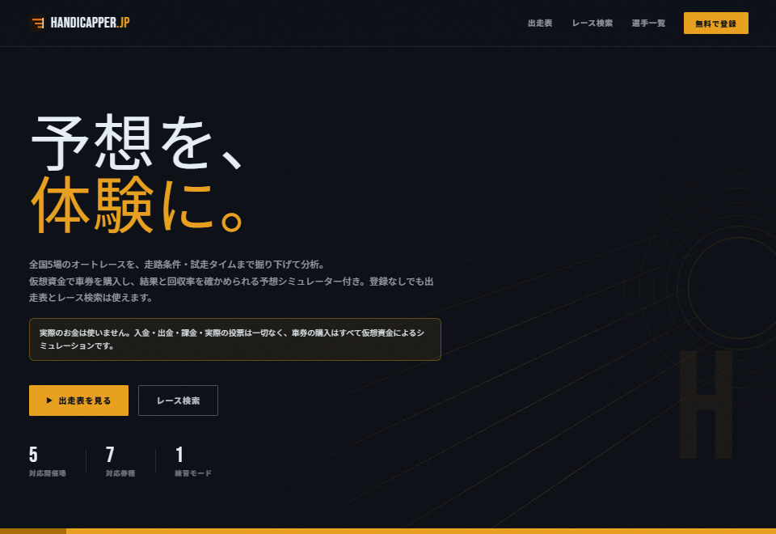
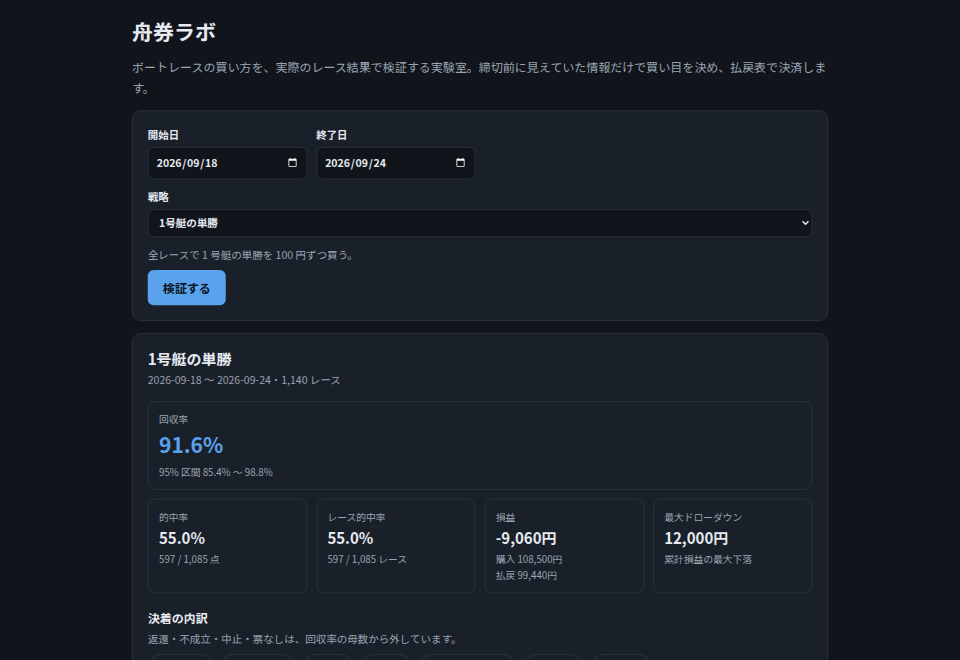

# ポートフォリオ

Web 版（shimomo.net）にだけ載せる「作ったもの」の一覧です。送付用の正本である resume.md には含めません。
「## 見出し」でグループ、「### 見出し」と表で 1 件を書きます。表の行は 説明 / 補足 / 画像 / リンク / バッジ / タグ で、説明以外は省略できます。
画像の行があるカードは横幅いっぱいの大きなカードになります（画像は index.html と同じ場所からの相対パス）。

## 運営中のサービス

### Handicapper.jp

| 項目 | 内容 |
| --- | --- |
| 説明 | オートレースの出走表を走路条件・試走タイム・直近成績まで掘り下げて分析できる Web サービス。全国 5 場の出走表・結果・オッズ・選手情報を日次で収集し、2005 年以降・約 12.9 万レースの確定結果を多条件で検索できます。仮想資金の予想シミュレーターで、予想の結果と回収率を確かめられます。 |
| 補足 | 企画・設計・実装・運用のすべてを一人で担当し、2026 年からシン VPS で稼働中。バッチの失敗やデータの欠落は DB とログ側から検知して Slack へ通知し、cron の停止は healthchecks.io で検知。GitHub Actions で CI と依存パッケージの監査を回しています。 |
| 画像 |  |
| リンク | [サイト](https://handicapper.jp/) |
| バッジ |  |
| タグ | PHP 8.4, Laravel, Vue 3, TypeScript, Inertia.js, Tailwind CSS, MariaDB, PHPUnit, Playwright, GitHub Actions, VPS |

### オートレース.jp

| 項目 | 内容 |
| --- | --- |
| 説明 | Handicapper.jp の姉妹サイト。同じデータを使った検証記事を公開するデータ分析メディアです。結論と数字を先に出し、母数・前提・確かめられなかったことまで含めて書く方針で運営しています。 |
| 補足 | 原稿は Markdown と frontmatter で管理し、HTML への変換・投稿・OGP 画像の生成をスクリプト化。WordPress の子テーマを自作し、さくらのレンタルサーバで運用しています。 |
| リンク | [サイト](https://xn--kck4a5byi2cc.jp/) |
| タグ | WordPress, PHP, Markdown, さくらのレンタルサーバ |

### 舟券ラボ

| 項目 | 内容 |
| --- | --- |
| 説明 | ボートレースの買い方を、2026 年以降の実際のレース結果で検証するバックテストの Web アプリ。戦略は締切前の情報だけを受け取る型で書くので、結果や確定オッズを読もうとするとコンパイルエラーになります。払戻は特払・不成立・返還を分けて払戻表で決済し、回収率にはレース単位のブートストラップで 95% 区間を付けます。 |
| 補足 | TypeScript 製の pnpm モノレポ（検証エンジンと React の画面）。データの取得と集計は Web Worker で回し、サーバーを持たずに GitHub Pages で公開しています。外部の JSON は zod で検証し、同着・特払・不成立といった境界ケースは実データから切り出したフィクスチャでテストしています。 |
| 画像 |  |
| リンク | [サイト](https://shimomo.github.io/funaken-lab/) / [GitHub](https://github.com/shimomo/funaken-lab) |
| バッジ |  |
| タグ | TypeScript, React, Vite, Vitest, zod, Biome, Web Worker, GitHub Actions, GitHub Pages |

## OSS・公開 API

### boatrace/*

| 項目 | 内容 |
| --- | --- |
| 説明 | ボートレースのデータ取得ライブラリ群。契約（types）・DI コンテナ（core）・汎用モジュール（support）・スクレイパー（scraper / scraper-boatcast）を個別パッケージに分割し、モノレポからリリースして Packagist で公開しています。 |
| リンク | [GitHub](https://github.com/shimomo/boatrace) / [Packagist](https://packagist.org/packages/boatrace/scraper) |
| バッジ |   |
| タグ | PHP, PHPUnit, Psalm, GitHub Actions, Packagist |

### Boatrace Open API

| 項目 | 内容 |
| --- | --- |
| 説明 | 全 24 場の出走表・直前情報・結果を JSON で公開する非公式 API。GitHub Actions で約 3 分ごとに更新し、GitHub Pages で配信しているので、サーバーを持たずに運用できています。 |
| リンク | [API](https://boatraceopenapi.github.io/api/) / [GitHub](https://github.com/boatraceopenapi/api) |
| バッジ |   |
| タグ | PHP, GitHub Actions, GitHub Pages |

### Turnmark API

| 項目 | 内容 |
| --- | --- |
| 説明 | Boatrace Open API の姉妹版。オッズを含めた前日までのデータを提供する、安定重視の API です。 |
| リンク | [GitHub](https://github.com/turnmark/api) |
| バッジ |   |
| タグ | PHP, GitHub Actions, GitHub Pages |

### Tenjisagi（展示詐欺）

| 項目 | 内容 |
| --- | --- |
| 説明 | スタート展示で見せた進入コースと本番の進入コースがどれだけ食い違うかを、選手ごとに数値化したランキング。自作 API のデータから生成し、素の HTML / CSS / JS だけで公開しています。 |
| リンク | [サイト](https://shimomo.github.io/tenjisagi/) / [GitHub](https://github.com/shimomo/tenjisagi) |
| バッジ |  |
| タグ | PHP, GitHub Actions, GitHub Pages |

### Narikiri

| 項目 | 内容 |
| --- | --- |
| 説明 | ngrok を起動するたびに変わる URL を Stripe の Webhook エンドポイントへ同期する CLI。Homebrew で配布しています。 |
| リンク | [GitHub](https://github.com/shimomo/narikiri) |
| バッジ |  |
| タグ | Go, Stripe, Homebrew |

### Tokyo Sports Scraper

| 項目 | 内容 |
| --- | --- |
| 説明 | 東京スポーツのオートレース情報を取得する Python ライブラリ。PyPI で公開しています。 |
| リンク | [GitHub](https://github.com/autorace/tokyo-sports-scraper) / [PyPI](https://pypi.org/project/autorace-tokyo-sports-scraper/) |
| バッジ |  |
| タグ | Python, pytest, PyPI |

### AutoRace News Collector

| 項目 | 内容 |
| --- | --- |
| 説明 | オートレースの最新記事を、AUTORACE.JP・日刊スポーツ・各レース場公式サイト・公式 YouTube のフィードと API から集める PHP ライブラリ。HTML の一覧ページはスクレイピングせず、保存・既読管理・重複排除は呼び出し側に委ねる設計で、取得に失敗したソースは例外ではなく結果の一部として返します。Handicapper.jp のトップページの記事枠で使っています。 |
| リンク | [GitHub](https://github.com/shimomo/autorace-news-collector) / [Packagist](https://packagist.org/packages/shimomo/autorace-news-collector) |
| バッジ |   |
| タグ | PHP, PHPUnit, Psalm, Pint, GitHub Actions, Packagist |

### AutoRace News

| 項目 | 内容 |
| --- | --- |
| 説明 | AutoRace News Collector で 1 時間ごとに集めた見出しを、公式のお知らせ・新聞記事・動画の 3 段に分けて、1 日 1 ページで眺めるサイト。GitHub Actions が収集してリポジトリにコミットし、GitHub Pages が配信するので、サーバーもデータベースも使いません。 |
| 補足 | AUTORACE.JP のサイトポリシーは無断の転載を禁じているため、公開するのは見出しとリンクだけにしています。一部の配信元の取得に失敗しても Actions の実行は失敗にせず、ページ上部の注意と job summary に出します。 |
| リンク | [サイト](https://shimomo.github.io/autorace-news/) / [GitHub](https://github.com/shimomo/autorace-news) |
| バッジ |  |
| タグ | PHP, PHPUnit, Psalm, Pint, JavaScript, GitHub Actions, GitHub Pages |

### Keirin News Collector

| 項目 | 内容 |
| --- | --- |
| 説明 | 競輪の最新記事を、KEIRIN.JP・新聞各紙・JKA 系サイト・競輪場 31 場の公式サイトのフィードと API から集める PHP ライブラリ。AutoRace News Collector と同じ設計で、ソースのキーによる絞り込みと、ページ送り上限の指定に対応しています。 |
| リンク | [GitHub](https://github.com/shimomo/keirin-news-collector) / [Packagist](https://packagist.org/packages/shimomo/keirin-news-collector) |
| バッジ |   |
| タグ | PHP, PHPUnit, Psalm, Pint, GitHub Actions, Packagist |

### Keirin News

| 項目 | 内容 |
| --- | --- |
| 説明 | Keirin News Collector で 1 時間ごとに集めた見出しを、新聞・メディア、公式・団体、競輪場のお知らせの 3 段に分けて、1 日 1 ページで眺めるサイト。AutoRace News と同じ作りで、選手の話題が多い新聞・メディアを先頭に置いています。 |
| 補足 | GitHub Actions の IP からの REST API を 403 で拒む 9 か所は RSS に切り替えて読み、ライブラリの WordPress 版と同じ ID を振って結果を揃えています。転載を禁じる配信元があるため、公開するのは見出しとリンクだけです。 |
| リンク | [サイト](https://shimomo.github.io/keirin-news/) / [GitHub](https://github.com/shimomo/keirin-news) |
| バッジ |  |
| タグ | PHP, PHPUnit, Psalm, Pint, JavaScript, GitHub Actions, GitHub Pages |

### SES フィルター

| 項目 | 内容 |
| --- | --- |
| 説明 | エンジニア求人サイト（paiza転職・Green・doda）の検索結果で、SES・派遣の求人を理由つきで畳む Chrome 拡張機能。「客先常駐」のような強い言い回しなら畳み、「参画」のような弱い言い回しだけなら要確認の印を付け、「客先常駐なし」「Amazon SES」のような否定や別の意味は数えません。判定はすべてブラウザの中で行い、閲覧内容を外部に送りません。 |
| 補足 | 保存した検索結果と正解ラベルで適合率・再現率を測りながらルールを調整し、ルールを直し終えてから集めた確かめ用のページで 1 回だけ測った数字を README に載せています。unit / e2e / eval の 3 層でテストしています。 |
| リンク | [GitHub](https://github.com/shimomo/ses-filter) / [記事](https://zenn.dev/shimomo/articles/9f66a551c41f1a) |
| タグ | TypeScript, WXT, Vitest, Playwright, Chrome 拡張機能 |

### Tech Trends

| 項目 | 内容 |
| --- | --- |
| 説明 | GitHub Trending と Zenn から、Web 系・AI 系で反応が多かったものを毎朝集めて 1 ページにまとめるサイト。前日の記録と比べて、スターやいいねが急に伸びたものと初登場のものに印を付けます。 |
| 補足 | どちらも非公式のページと API を読むので、構造が変わって収集が失敗したら Actions の実行を赤くし、ページにも注意を出します。取れた分はそのまま表示します。 |
| リンク | [サイト](https://shimomo.github.io/tech-trends/) / [GitHub](https://github.com/shimomo/tech-trends) |
| バッジ |  |
| タグ | TypeScript, Vitest, Biome, GitHub Actions, GitHub Pages |

## 検証と記事

### PHP 8.6 clamp() の検証

| 項目 | 内容 |
| --- | --- |
| 説明 | PHP 8.6 で追加される `clamp()` の挙動を、公式 Docker イメージの 8.6.0RC2 で確かめた検証環境と記事。型変換をしないことや、空配列で ValueError になるなど `max(min())` から置き換えると変わる点、自前の `clamp()` がある場合の影響、polyfill との差を確かめました。 |
| 補足 | すべてのテストを run.sh 1 本で再実行でき、記事に載せた出力はすべて記録したログから写しています。RFC の経緯も、RFC と php-src の PR をたどって年表にしました。 |
| リンク | [記事](https://zenn.dev/shimomo/articles/8499e432bac303) / [GitHub](https://github.com/shimomo/lab-php86-clamp) |
| タグ | PHP 8.6, Docker, Shell, Composer |

### laravel/vet の検証

| 項目 | 内容 |
| --- | --- |
| 説明 | Composer の依存の更新を差分と AI エージェントで審査する laravel/vet（v0.2.1）を、手元で配る架空の悪性パッケージで確かめた検証環境と記事。autoload の外だけを変えた版はエージェントに中身が渡らず PASS になるなど、止めるものと止めないものを手順ごとに記録しました。 |
| 補足 | テスト用の認証局と https サーバーで架空パッケージを配り、スタブのエージェントが受け取ったプロンプトを保存したうえで、本物の Claude Code にもレビューさせて結果を比べています。 |
| リンク | [記事](https://zenn.dev/shimomo/articles/299809443d5505) / [GitHub](https://github.com/shimomo/lab-laravel-vet) |
| タグ | PHP, Composer, laravel/vet, Python, Claude Code |
